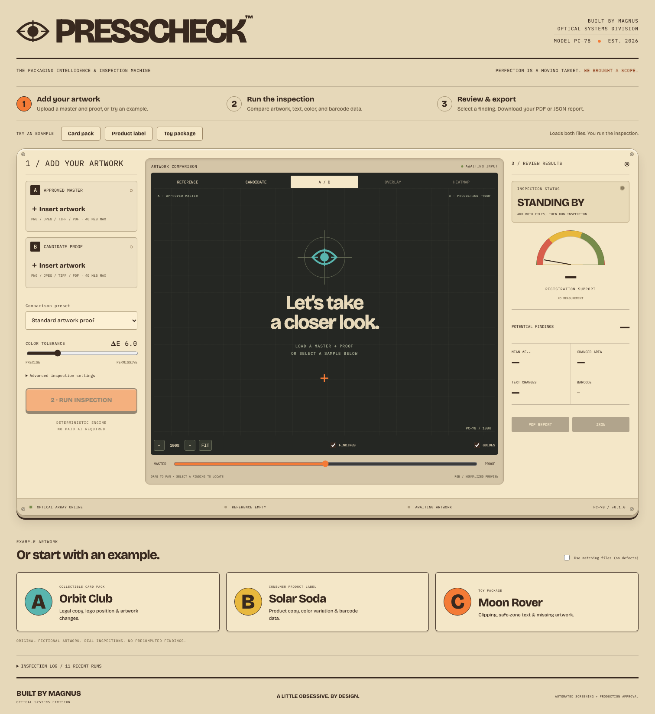
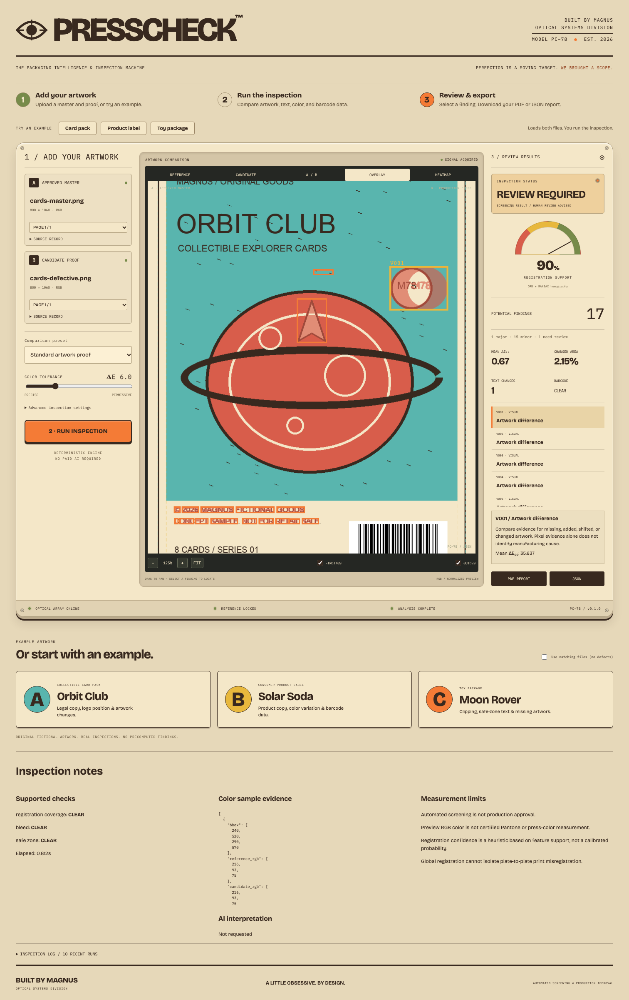

# PRESSCHECK™
**The Packaging Intelligence & Inspection Machine.** Built by Magnus / Optical Systems Division / Model PC-78.

*Perfection is a moving target. We brought a scope.*

PRESSCHECK is a local-first, open-source packaging artwork inspection application. Compare an approved master with a candidate proof, examine measured differences, and export evidence. The console borrows its proportions, colors, and controls from an imaginary 1978 optical instrument.

This is a working engineering prototype, not a certified print-preflight or production-approval system. Optional vision interpretation is separate from the deterministic inspection engine.



## As easy as 1, 2, 3

1. **Add artwork.** Upload your approved master and proof, or choose Card pack, Product label, or Toy package to load original fictional examples.
2. **Run inspection.** Press the orange button. A real background job registers the images and inspects the selected pages.
3. **Review & export.** Choose a finding to highlight its bounds, compare A/B views, and download PDF or JSON evidence.

Advanced settings are optional. They expose thresholds, rectangular trim, bleed and safe insets, color sample regions, OCR, barcodes, and opt-in AI interpretation.

## Local setup (no paid API key)

Requirements: Python **3.14**, Node **24**, Tesseract **5** with English data, and [uv](https://docs.astral.sh/uv/). macOS: `brew install tesseract`. Ubuntu: `sudo apt-get install tesseract-ocr fonts-dejavu-core`.

```bash
git clone https://github.com/d5dtgpt59z-cell/presscheck.git
cd presscheck
uv venv --python 3.14
uv pip install --python .venv/bin/python -r requirements.txt
cd frontend
npm ci
cd ..
./scripts/dev.sh
```

Open **http://127.0.0.1:3000**. API and interactive OpenAPI documentation: **http://127.0.0.1:8000/docs**. Stop both services with Ctrl+C. Uploaded sources, metadata, job records, evidence, and reports persist under `data/` (gitignored). The console restores the last inspection on refresh and includes a recent inspection log.

Optional server configuration is in `.env.example`. To load a local `.env` for the API, start it with `PYTHONPATH=backend .venv/bin/uvicorn presscheck.api:app --env-file .env`. The normal dev script uses exported environment variables. Do not commit secrets.

### Docker / PostgreSQL

```bash
docker compose up --build
# Open http://127.0.0.1:3000
```

Compose runs Next.js, FastAPI/Tesseract, and PostgreSQL with persistent volumes and loopback-only exposed ports. The built frontend proxies `/api` to the API container. Stop with `docker compose down`; add `-v` only to deliberately discard stored artwork/database volumes. The bundled password is for isolated local development only. See [security notes](SECURITY.md).

## What works

- PNG/JPEG/TIFF frames and up to 20 PDF pages; page selection, source SHA-256, mode, dimensions, DPI, embedded ICC record, preserved original and ICC bytes.
- EXIF orientation, alpha over white, bounded 1600-pixel previews. Embedded raster profiles use LittleCMS via Pillow for conversion to sRGB. Untagged CMYK and PDF rendering carry explicit warnings.
- Orthogonal orientation search, ORB matching, RANSAC homography, feature-support quality, geometric shift/scale evidence, registered coverage/clipping screening.
- Smoothed sRGB-to-Lab CIEDE2000, configurable color regions/tolerances, changed-area measurements, heatmaps and annotated overlays.
- Tesseract word comparison with confidence and source/candidate bounds; barcode regions are excluded from OCR, and their payloads compared through ZXing separately.
- ZXing barcode payload/readability comparison. No readable reference code means barcode correctness is **unavailable**, never an implicit pass.
- Rectangular trim canvas/bleed extent and OCR text safe-zone screening. No configured trim means those checks are **unavailable**.
- SQLAlchemy SQLite local mode / PostgreSQL Compose mode, persistent queued jobs, one background worker, restart recovery, JSON and PDF reports.
- Canvas split slider, master/candidate/overlay/heatmap views, zoom/pan, selectable findings, trim/safe guides, responsive layout, keyboard-operable controls and reduced-motion support.
- Optional cloud or local OpenAI-compatible vision explanation, labeled and tied to measured finding IDs. It never changes measured results or status. No credentials are needed for deterministic inspection.



## Status rules

Default rules are configurable through the API and Advanced settings:

| Result | Rule |
| --- | --- |
| INCONCLUSIVE | Registration support < 0.55, or an explicitly enabled OCR/barcode engine is unavailable |
| FAIL | Registered changed-region area >= 8% of valid comparison area |
| REVIEW REQUIRED | One or more visual, OCR, barcode, geometric, bleed, or safe-zone findings below the FAIL area threshold |
| PASS | Reliable correspondence and no findings at configured thresholds |

Unavailable trim checks and unreadable reference barcodes remain visible even on a PASS: a PASS covers only supported checks. Visual regions over 5,000 changed pixels are labeled major; smaller regions are minor. OCR/geometry/barcode findings require review. These severity labels describe screening evidence, not a calibrated manufacturing risk rating. Connected regions below 45 pixels and details removed by a 3×3 morphological opening are suppressed by default. Up to 200 visual regions are listed; changed-area scoring includes all eligible regions, even if the finding display is capped.

**PASS is not production approval.** Homography support is a heuristic, not a probability. Read [limitations](docs/LIMITATIONS.md) before assessing real packaging.

## Validation and reproducibility

```bash
PYTHONPATH=backend .venv/bin/python -m pytest backend/tests -q
PYTHONPATH=backend .venv/bin/python scripts/benchmark.py
# With the real API and console running:
cd frontend
npx playwright install chromium
npm run test:e2e
npm run build
```

The checked-in synthetic dataset contains 33 evaluation pairs (27 injected-defect and six negative controls), three combined-defect demos, and ingestion fixtures. It is original fictional artwork, with no client or licensed commercial assets. Regenerate it with `.venv/bin/python scripts/generate_dataset.py`; fonts differ between macOS Arial and Linux DejaVu, so prefer the committed dataset for exact reproduction.

Local measured sample-level results: **27 true positives, 1 false positive, 0 false negatives, 5 true negatives**; precision **96.43%**, recall **100%**, false-positive rate **16.67%**. This is a tiny, development-used synthetic set, not a held-out or real-world validation. See [methodology and failure analysis](docs/BENCHMARKS.md) and [raw measurements](docs/benchmark-results.json). No defect localization accuracy or press accuracy is claimed.

[Sample PDF report](docs/sample-report.pdf) · [Sample JSON report](docs/sample-report.json) · [Architecture](docs/ARCHITECTURE.md) · [API](docs/API.md) · [Demo walkthrough](docs/DEMO.md) · [Validation record](docs/VALIDATION.md)

## License

AGPL-3.0-or-later; see [LICENSE](LICENSE). PyMuPDF is an AGPL/commercial dual-licensed dependency. Vendored Bricolage Grotesque and IBM Plex Mono fonts use their included SIL Open Font License files. Dataset artwork is included under this repository's license. No claim of trademark registration is made by the product styling.
