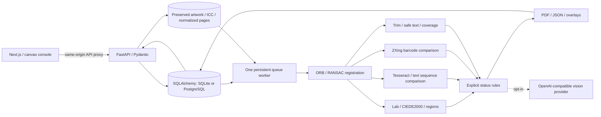

# Architecture

## Boundaries and decisions

- `ingestion.py` preserves the original and generates bounded previews; normalization is explicit and separate from measurement.
- `registration.py` estimates candidate-to-reference correspondence across four orthogonal orientations. Distributed ORB support, inlier fraction, and match count form an uncalibrated quality indicator. Unreliable alignment prevents a definitive status.
- `color.py` measures CIEDE2000 after mild 3×3 smoothing in assumed/profile-converted sRGB. Sample values and tolerances are retained.
- `text.py` compares OCR word sequences; ZXing-decoded regions are masked from OCR to avoid reading barcode stripes as text. OCR suggestions remain uncertain.
- `geometry.py` provides rectangular canvas/bleed extents and OCR safe bounds. Unknown intent or absent geometry is unavailable.
- `engine.py` composes stages, emits measured findings, scores supported checks and writes evidence; it does not own API or database state.
- `ai.py` speaks an OpenAI-compatible multimodal HTTP contract. Cloud and local providers share one adapter configured by environment. It is never in the scoring path.
- `reports.py` produces reviewer-readable summaries; JSON retains complete structured evidence.
- `storage.py`, `worker.py`, `api.py` own persistence, queue execution, and HTTP access.
- `frontend/app/page.tsx` contains the console and canvas viewer; vanilla CSS implements the instrument surfaces without a component-library dependency.

SQLite was chosen for an immediate local-first start. PostgreSQL uses the same SQLAlchemy models through `DATABASE_URL`. One API process starts exactly one worker thread: **do not deploy multiple Uvicorn workers or API replicas**. Jobs are durable, but queue claiming is not distributed. Interrupted running jobs requeue on restart; there is no at-most-once guarantee. A broker-backed isolated worker would be required for scale and native-code timeouts.

The frontend uses Next.js/TypeScript, locally hosted OFL fonts, and plain CSS rather than Tailwind. Styling is bespoke and does not require runtime third-party assets. No generated imagery or paid model was needed.
